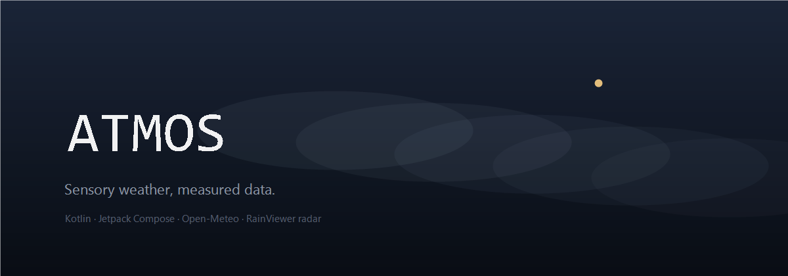

# ATMOS

**Sensory weather, measured data.**

ATMOS is a native Android weather surface built with Kotlin and Jetpack Compose. The interface treats
weather as part of the visual system — a living storm object, rain that crosses the whole screen, and
typography that stays readable while the atmosphere moves behind it.

The visual language is deliberately restrained: Midnight Blue `#121824`, deep navy surfaces `#222A3A`,
Geist and Geist Mono, a muted ice accent for water, restrained warm gold for sun, and a single controlled
red for genuine hazards. No neon, no candy gradients, no decorative values.



---

## Download

The signed release APK is attached to [Releases](../../releases/latest).

- Minimum Android 10 (API 29)
- Target / compile Android 16 (API 36)
- `arm64-v8a`, `armeabi-v7a`, `x86_64`

## What is inside

### The main surface
- Cinematic weather object that is generated, never a static image: volumetric cloud layers, rim light,
  gold motes, depth-sorted rain, snow, multi-layer fog, sunlight and cloud drift.
- Lightning exists **only** when the WMO code is a thunderstorm. It never claims a strike time or place.
- 96sp Geist Mono temperature at 87% white, condition, feels-like, humidity and wind beneath it.
- Focus cards for UV, wind, humidity, pressure, visibility, air quality, next-hour rain and sun.
  Every card opens a detail sheet with hourly context and an explicit data note.

### Forecast
- Next 24 / 48 hours with a temperature chart and a separate precipitation chart.
- Probability and amount are **separate** throughout the app: chance of measurable precipitation is never
  drawn as a quantity.
- ECMWF ensemble spread (51 members) shown as a 10–90% uncertainty band. If the ensemble is unavailable,
  the band is omitted rather than estimated.
- Seven-day outlook with daily totals, gusts, UV and sun times.

### Radar map
- Keyless Esri Dark Gray Canvas basemap (base + label overlay) with RainViewer radar frames.
  No API key is embedded or required; the previous CARTO endpoint now answers with an
  "API KEY REQUIRED" watermark tile and was replaced.
- Observed frames and nowcast frames are labelled differently.
- Play / pause, frame scrub, opacity control, pinch zoom and pan.

### Short-range nowcast and rain alerts
- Home shows a narrow nowcast strip when the 15-minute series has rain within two hours:
  onset, end and the next-hour amount with peak probability.
- Optional local notification when rain is likely to start within ~45 minutes. Off by default,
  at most one nudge per 90 minutes, and always labelled as nowcast — never as an official warning.

### Widgets
Five independent widget families, all fed by the same cached model output:
1. **Now** — temperature, condition, today's range, feels-like, humidity and wind.
2. **Hourly** — next six hours with precipitation chance.
3. **Air & exposure** — European AQI, UV, wind and humidity.
4. **Compact 2×2** — square tile with temperature, condition and range.
5. **Strip 4×1** — one-line temperature, sky and rain chance.

Widgets can be pinned from *More → Home screen widgets*. They refresh every 30 minutes and after every
successful app refresh. They never show data the app has not fetched.

### Settings
- Forecast model: Best match, ECMWF IFS 0.25°, DWD ICON, NOAA GFS, Météo-France AROME.
- Units: °C/°F, km/h · m/s · mph · kn, hPa/inHg, mm/in.
- Interface language: System, English, Türkçe, Deutsch, Español, Français — applied instantly, without
  restarting the app. Widgets, dates, AQI/UV scales and the geocoder follow the same choice.
- Adaptive animation quality, reduce-motion mode, lightning haptics.
- Opt-in rain nowcast alerts and an accent-only Material You option (Android 12+). The Midnight
  background, contrast and typography stay fixed.
- Device location opt-in, saved cities, data-source transparency.

---

## Data accuracy

ATMOS is built around a few non-negotiable rules:

| Rule | Implementation |
| --- | --- |
| Never fabricate values | Missing API fields stay `—`. There is no fallback weather table. |
| No mock data in the UI | Every number comes from a live or clearly marked cached response. |
| Separate observation and forecast | Current values are labelled *model analysis*; radar frames are labelled *observed* or *nowcast*. |
| Probability ≠ amount | They are separate fields, separate charts and separate sentences. |
| Show freshness | Every screen exposes the fetch age; cached data is labelled `Cached`. |
| Communicate uncertainty | Ensemble spread is shown where available and omitted where not. |
| No fake lightning | The flash only exists for thunderstorm codes; it is an atmosphere cue, not a strike report. |
| Official warnings are distinct | Where a public keyless CAP feed exists (US NWS) warnings are ingested verbatim and labelled *official*; elsewhere the hazard banner stays an explicit forecast signal. |

Sources:

- **Open-Meteo** — numerical forecast, geocoding, air quality, ensemble. [open-meteo.com](https://open-meteo.com)
- **ECMWF IFS 0.25°** — global medium-range model and 51-member ensemble.
- **DWD ICON**, **NOAA GFS**, **Météo-France AROME** — optional regional/global model selections.
- **CAMS** — European air-quality analysis and forecast.
- **RainViewer** — observed radar and short-range nowcast.
- **Esri Dark Gray Canvas / OpenStreetMap** — basemap tiles and labels.
- **US National Weather Service** — official CAP alerts (`api.weather.gov`, public and keyless).

ATMOS ingests official national warnings only where a public, machine-readable feed exists — currently
the US National Weather Service. For other regions the app says so instead of inventing an alert, and the
hazard banner remains a forecast signal. For life-safety decisions, always follow your national
meteorological service (MeteoAlarm links are provided in-app).

Read [docs/ACCURACY.md](docs/ACCURACY.md) for the full data contract.

---

## Build

Requirements: JDK 17+, Android SDK 36.

```bash
git clone https://github.com/tutualican/atmos.git
cd atmos
./gradlew :app:assembleDebug
```

Release signing is optional and driven by a git-ignored `keystore.properties`:

```properties
storeFile=/absolute/path/to/release.jks
storePassword=...
keyAlias=...
keyPassword=...
```

Without the file, `assembleRelease` produces an unsigned APK and the debug build still works.

Run the data tests:

```bash
./gradlew :app:testDebugUnitTest
```

## Architecture

```
core/        Models, WMO code mapping, settings, cache bundle
data/        Open-Meteo client + parser, cache, radar, official CAP alerts, tiles, Web Mercator
location/    Permission-aware device location + reverse geocoding
notify/      Nowcast rain outlook + opt-in local alerts (no push service)
ui/scene/    Weather animation engine (Canvas, frame-budget adaptive)
ui/screens/  Home, Forecast, Map, More, detail, official-alert and location sheets
ui/components/  Design system + hand-built Lucide-style icon set
i18n/        Runtime string tables (EN source, TR/DE/ES/FR) + localized Text wrapper
widget/      Five RemoteViews widget providers + shared renderer
```

- Single source of truth: `AtmosViewModel` → immutable `AtmosUiState`.
- The animation loop runs only while the composition is active, uses `withFrameNanos`, and scales particle
  count from measured frame time. No animation while the app is in the background.
- Offline behaviour replays the last **raw** payload and marks it as cached. Parsing never invents a value.

## Accessibility & layout

- All content is scrollable; cards size with intrinsic row heights; long labels ellipsize instead of clipping.
- Dynamic type is respected; the temperature column yields space to the condition text.
- Touch targets are at least 40dp; controls carry content descriptions.
- Motion can be reduced globally; haptics follow the system ringer mode.

## Licence

MIT. Weather data is subject to the providers' terms (Open-Meteo licence, RainViewer, Esri, OpenStreetMap).
